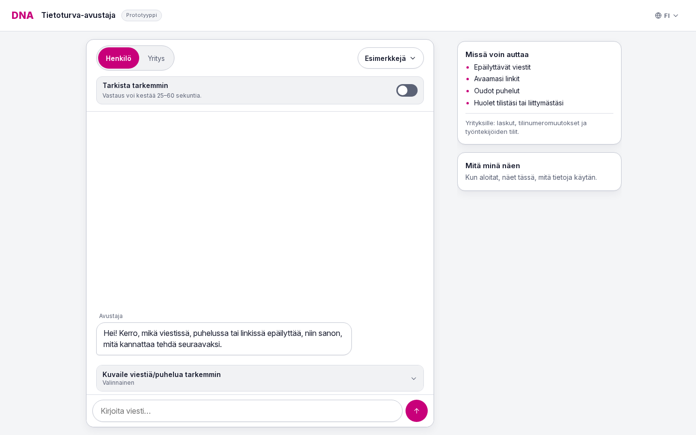
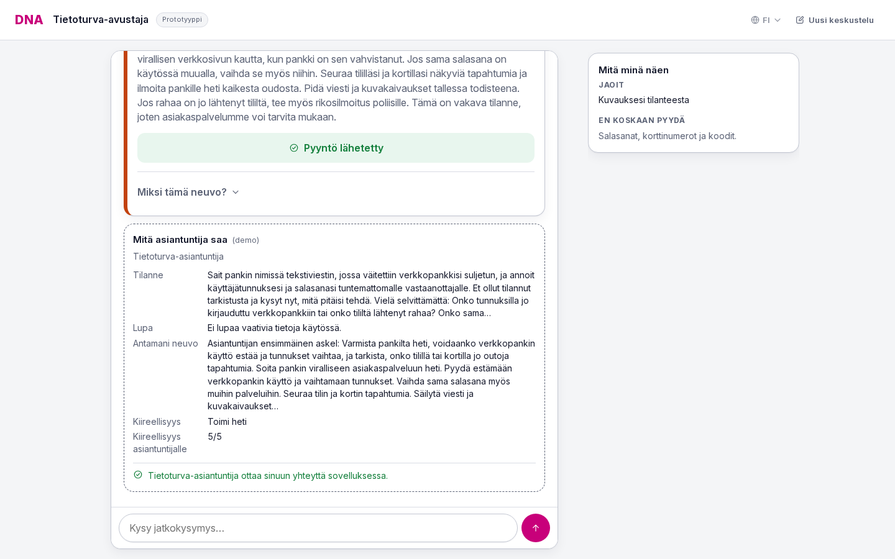

# DNA digital security assistant

The assistant turns a description of a suspicious call, message or link, plus operator risk signals, into one proportionate next step in Finnish, English or Swedish.

The project answers the DNA Oyj challenge "Digital Security Assistant: What Should I Do Now?" at Since AI Hackathon 2026 in Turku. It is a prototype, and all case data is synthetic.

## RUNNING THE DEMO

Setup and run instructions are in app/README.md.

## SCREENSHOTS

The desktop start screen.

A recorded expert handoff with the situation summary and queue priority.

## THE PROBLEM

Consumers and small businesses receive warnings such as "suspicious link" or "possible scam call". A warning names a risk but gives no next step, so people ignore it, panic or follow the wrong advice.

## HOW THE ASSISTANT ANSWERS

The assistant runs inside an operator app or business portal. It reads the user's description, any attached message, call or link, and the operator's signals: call warning, link check, device and account state. It then:

1. Asks one decisive question at a time when a missing fact changes the answer, such as whether the user entered details or started a change themselves.
2. Asks consent before using optional data. A refusal is final.
3. Gives one action with a short reason in plain language.
4. Hands off to a human when money, an account, a SIM, a device or a person's safety is at risk.

New facts in a follow-up can revise the answer. Typing "stop" ends the chat.

## URGENCY AND OPERATOR PRIORITY

Every answer carries an urgency rating: none, routine, today or immediate. The user sees it as a label beside the advice.

An escalated case also gets a handoff brief for a human operator, with a priority from 1 to 5. Level 5 means money is moving or an account or device is being taken over. The operator decides whom to help first from these ratings, which is a step towards routing cases into DNA's customer service.

The model writes the brief after the advice is shown. The handoff card shows "Preparing the brief" until it is ready, then the situation summary, open questions and the expert queue priority, such as "4 of 5". If the brief cannot be written, the card says so, and no automatic summary replaces it.

## ARCHITECTURE

DeepSeek V4.1 Flash, through the Featherless API, writes each answer as JSON. A deterministic layer, `normalise()`, then checks every field. It removes invented citations, wrong-language advice and data the user did not consent to share. It may raise caution on its own, but a "nothing to do" answer needs the model's verdict or two independent benign facts. If the model fails, a rules baseline answers.

Data the user has not granted reaches the model only as a placeholder. Retrieval adds up to three guidance passages, which the answer cites.

The demo runs in fast mode by default. The "Check more carefully" switch turns on the model's reasoning, at 25 to 60 seconds per reply, and the submitted test predictions use it. The backend uses the Python standard library and the dataset's toolkit.

## RESULTS

All figures come from the synthetic SimSet v2.0.1 with consent enforced.

- Five sample journeys: 5 of 5 pass, with no automated unsafe flags.
- Multi-turn development set (24 conversations): 22 pass, with no automated unsafe flags, no consent violations and all 6 required handoffs.
- Full single-turn development set (588 cases), thinking ON: 489 pass (83.2 %), with 11 automatic unsafe flags and 23 false alarms among 132 benign cases.
- Full single-turn development set (588 cases), thinking OFF: 417 pass (70.9 %), with 20 automatic unsafe flags and 33 false alarms among 132 benign cases.
- Earlier single-turn baseline samples tune100 and tune100b: 80 % and 83 % pass.
- Earlier own unseen baseline (32 single-turn cases): 19 pass.
- Test set: the model answered all 335 inputs with no rules fallback, and the official validator accepts the file.

The test inputs have no reference answers, so the test run shows coverage, not accuracy.

The full development figures are automatic evaluator results, not a safety certification. Pattern-based unsafe flags require review. Saved predictions, scores and run details are in results/dev-full/.

Evaluation details and failure examples are in RESULTS.md. The earlier baseline figures do not measure the selected engine.

## KNOWN LIMITATIONS

1. Fast mode. Without reasoning, the eSIM journey can skip the question of whether the user started the change. The earlier fast-mode check passed 4 of 5 journeys and 17 of 24 development conversations.
2. Single-turn escalation. The earlier own unseen check missed six required handoffs. This check was not repeated for the selected engine.

## WAY FORWARD

1. Finding balance between fast mode and thinking mode. Perhaps some hybrid that uses one or the another depending on the type of situation. Another possibility would be to use some another faster and better language model.
2. Off-load more of the work of the operator to the AI. Perhaps it could have some per determined documentation according to which to gives assistance.
3. Connect the priority rating and handoff brief to the expert's work queue. The operator mockup shows escalated cases beside a summary and the signals checked. An expert could use the rating to decide whom to help first and read the context before starting the conversation.

## BUILT WITH

Python, DeepSeek V4.1 Flash, Featherless AI, HTML, CSS, JavaScript
